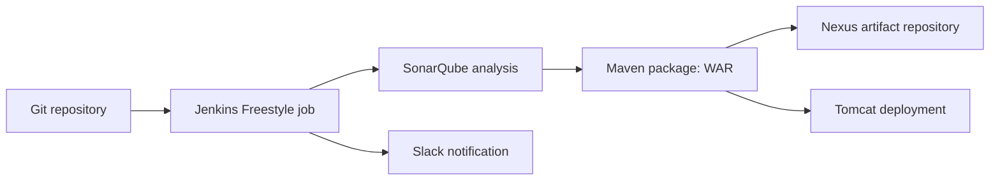

# Jenkins Freestyle CI/CD for a Maven Application

A documented CI/CD workflow based on the uploaded project PDF. A Jenkins Freestyle job builds the `betawins/hiring-app` Maven project and integrates source checkout, SonarQube analysis, Maven packaging, Nexus artifact upload, Slack notifications, and deployment to Apache Tomcat.

> **Status:** Documentation and reusable examples are prepared from the source material. The workflow has not been run from this repository in a fresh AWS account. Validate versions, plugin compatibility, credentials, and network rules before using it.

## What the project demonstrates

- Jenkins Freestyle job configuration (not a declarative Jenkinsfile pipeline).
- Git checkout of `https://github.com/betawins/hiring-app.git`.
- Java 17 and Maven build configuration.
- SonarQube quality analysis using a Jenkins-managed secret.
- Publishing a Maven artifact to Nexus Repository Manager.
- Slack build notifications.
- WAR deployment to Apache Tomcat using the Jenkins deploy-to-container plugin or an equivalent authenticated deployment step.
- AWS EC2-based lab infrastructure, with optional Terraform examples.

## Workflow



## Source-derived environment

The PDF describes Jenkins on a Red Hat-family host, SonarQube in Docker exposed as host port `9003` to container port `9000`, Maven `3.9.9`, Nexus Repository Manager `3.0.2-02`, and Tomcat `10.1.33`. It names Java 17 for Jenkins/build and Tomcat, while its Nexus setup references Java 8. These are historical versions from the source, not current-version recommendations. Nexus 3.0.2-02 and Tomcat 10.1.33 should not be deployed publicly without a compatibility and security review.

## Repository map

- `index.html` — dark documentation website for GitHub Pages.
- `docs/architecture.md` — system architecture and data flow.
- `docs/runbook.md` — setup, job configuration, verification, and rollback guidance.
- `docs/security.md` — secrets and network hardening.
- `docs/resume-content.md` — resume and LinkedIn wording.
- `terraform/` — optional parameterized EC2/security-group example; review before apply.
- `ansible/` — basic connectivity and host preflight playbook.
- `jenkins/freestyle-job/` — job configuration checklist and build steps.
- `scripts/` — local validation helper.

## Prerequisites

- AWS account and a least-privilege identity if using the Terraform example.
- Terraform 1.5+ and AWS CLI v2.
- Jenkins, Git, Java 17, Maven, SonarQube, Nexus Repository Manager, Slack workspace/app, and Apache Tomcat versions chosen and compatibility-tested for your environment.
- A Jenkins agent that can reach the Git host, SonarQube, Nexus, Slack endpoints, and Tomcat manager endpoint.

## Configure the Freestyle job

1. Install/configure Git, Maven, Java, SonarQube Scanner, Slack Notification, Nexus Artifact Uploader, and Deploy to Container plugins as needed. Prefer supported plugin versions and record them in your environment inventory.
2. In **Manage Jenkins → Tools**, configure the JDK, Maven, and SonarQube Scanner installations.
3. In **Manage Jenkins → System**, configure SonarQube server URL and credentials, Slack workspace/credential/channel, and Nexus endpoint/credentials as supported by installed plugins.
4. Create a Freestyle job and set the Git repository to `https://github.com/betawins/hiring-app.git`. Configure branch and webhook/polling strategy.
5. Add build steps in this order: SonarQube environment/analysis, Maven goals `clean verify` (confirm the project supports them), and any required quality-gate wait. The exact analysis properties must match the repository's `pom.xml` and SonarQube project configuration.
6. Add Nexus artifact upload using the actual artifact coordinates and WAR path produced by Maven. Do not guess coordinates; check `pom.xml` and the build output.
7. Add post-build Slack notifications for success/failure.
8. Deploy the WAR to Tomcat using a dedicated deployment account and TLS/private network. Avoid the PDF's example `deployer/deployer` credentials.
9. Build once, inspect each stage's console output, verify the artifact in Nexus, confirm SonarQube analysis, check Slack, and smoke-test the application URL.

## Terraform example

The `terraform/` folder is an optional lab scaffold, not a turnkey multi-service deployment. Copy `terraform.tfvars.example` to `terraform.tfvars`, set a valid AMI for your chosen region and your own SSH public key, then run `terraform init`, `terraform fmt -check -recursive`, `terraform validate`, and `terraform plan`. Review all ingress rules before applying. Never commit real `.tfvars` files or credentials.

## Validation

```bash
terraform -chdir=terraform fmt -check -recursive
terraform -chdir=terraform init -backend=false
terraform -chdir=terraform validate
ansible-playbook -i ansible/inventory.example.ini ansible/preflight.yml --syntax-check
```

These commands validate configuration syntax only; they do not prove the full CI/CD workflow works.

## Cost and cleanup

EC2, EBS, public IPv4 addresses, data transfer, and running service instances may incur charges. If you created resources with this Terraform configuration, inspect the plan and run `terraform -chdir=terraform destroy` when finished. Remove any separately created resources that Terraform did not manage.

## Screenshots

The source PDF contains screenshots of Jenkins, SonarQube, Nexus, job configuration, build output, Slack, and the deployed app. Screenshots containing public IPs, tokens, default credentials, or account details are not copied into this public repository. Capture sanitized screenshots from your own environment and place them in `docs/screenshots/`.

## GitHub Pages

In GitHub, open **Settings → Pages**, choose **Deploy from a branch**, select `main` and `/ (root)`, and save. The static site is `index.html`.


## Source PDF screenshots

The `docs/screenshots/` directory contains page images from the supplied seven-page project PDF. Images are linked from [`index.html`](index.html) and include the original setup and validation evidence. Visible tokens and example credentials were redacted before publishing.
